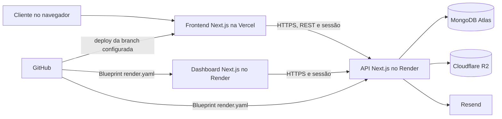

# Brasil Gravações

Aplicação web para apresentar serviços de gravação, receber pedidos de orçamento, armazenar artes dos clientes e acompanhar pedidos. O repositório mantém frontend, API e dashboard administrativa em aplicações separadas, com um pacote compartilhado para o catálogo de serviços.

> Este README é o guia principal do projeto. As variáveis de ambiente de produção ainda precisam ser configuradas nos painéis dos provedores; nenhum segredo deve ser salvo neste documento ou no Git.

## Tecnologias e serviços

| Tecnologia/serviço | Papel neste projeto |
| --- | --- |
| **GitHub** | Repositório do código e origem dos deploys automáticos. |
| **TypeScript** | Linguagem das aplicações e dos módulos de domínio. |
| **npm workspaces** | Gerencia as três aplicações Next.js e o pacote compartilhado a partir de um único `package-lock.json`. |
| **Next.js e React** | Frontend web, dashboard administrativa e aplicação separada que fornece a API REST. |
| **Vercel** | Hospeda o frontend Next.js. |
| **Render** | Hospeda a API REST e a dashboard; `render.yaml` configura Web Services Node.js 22. |
| **MongoDB Atlas** | Banco de dados MongoDB usado pela API para contas, orçamentos, pedidos, arquivos e controle operacional. |
| **MongoDB Node.js Driver** | Acesso da API ao Atlas e criação de índices/validadores. |
| **Better Auth** | Cadastro e login por e-mail/senha, sessões, OAuth Google opcional e papéis de usuário/administrador. |
| **Google Cloud Console** | Emissor das credenciais OAuth necessárias para ativar o login Google. |
| **Cloudflare R2** | Armazena os arquivos binários enviados pelos clientes. |
| **AWS SDK for JavaScript v3** | Usa a API compatível com S3 do Cloudflare R2 a partir do backend. |
| **Resend** | Envia confirmações de e-mail e alertas de capacidade do R2. |
| **Styled Components** | Estilos e temas do frontend. |
| **Motion** | Animações de entrada, saída e transição de componentes. |
| **React Icons e Swiper** | Ícones e componentes de carrossel. |

O serviço de login Google só fica disponível quando `GOOGLE_CLIENT_ID` e `GOOGLE_CLIENT_SECRET` são configurados na API.

## Arquitetura



O navegador chama `/api/*` no domínio do próprio site. Os rewrites do frontend encaminham essas requisições à API definida em `NEXT_PUBLIC_API_URL`. A API no Render valida a sessão, aplica as regras de negócio e acessa MongoDB/R2; as credenciais ficam apenas no backend.

A dashboard é um app separado em `dashboard/`; no Render, o Blueprint encaminha suas chamadas para a API pela rede privada. Configure a origem pública da dashboard também em `FRONTEND_ORIGINS` na API.

## Estrutura do repositório

```text
src/                         Frontend Next.js publicado na Vercel
  app/                       Páginas: início, serviços, painel e administração
  components/                Componentes da interface
  lib/                       Cliente HTTP, sessão, conta e utilitários do navegador
  styles/                    Temas, estilos e design system
dashboard/                   Dashboard Next.js independente, publicada no Render
  src/app/                   Login e visão administrativa
  src/styles/                Layout da dashboard com o tema compartilhado
backend/                     Aplicação Next.js separada, publicada no Render
  src/app/api/               Rotas HTTP da API
  src/server/                Autenticação, persistência e regras de negócio
  scripts/start.mjs          Inicializa a API na porta fornecida pelo Render
packages/domain/             Catálogo de serviços compartilhado
docs/                        Documentação técnica complementar
render.yaml                  Blueprint de implantação da API no Render
.env.example                 Modelo da variável local do frontend
backend/.env.example         Modelo das variáveis locais da API
```

O `backend/` usa Next.js Route Handlers para implementar endpoints JSON. É uma aplicação Node.js separada do frontend, embora ambas compartilhem o mesmo repositório e os workspaces do npm.

## Páginas do frontend

| Caminho | Conteúdo |
| --- | --- |
| `/` | Página inicial e catálogo de métodos de gravação. |
| `/servicos/[slug]` | Página dinâmica de cada serviço, com produtos, formulário e fluxo de orçamento correspondente. |
| `/painel` | Área autenticada do cliente para seus arquivos e atividade da conta. |
| `/admin` | Redireciona para a dashboard administrativa independente. |

A dashboard é servida pela aplicação `dashboard/` (porta local 3100). Ela lista os orçamentos recentes, os associa às contas dos clientes e informa o estado do R2. O painel do cliente em `/painel` também mostra seus próprios orçamentos. Os detalhes de configuração estão em [docs/dashboard-admin.md](docs/dashboard-admin.md).

A rota de serviço usa o catálogo em `packages/domain/engraving-methods.json`. A propriedade `supportsPreQuote` define se aquele método oferece cálculo automático ou segue para análise/orçamento via WhatsApp.

O formulário de contato coleta nome, empresa, telefone, celular, CNPJ, título e mensagem. Nome, título, mensagem e ao menos um telefone são obrigatórios; empresa e CNPJ são opcionais. Os envios públicos são validados e guardados em `customers`.

## API REST

Os recursos de negócio usam o prefixo `/api/v1`. A autenticação Better Auth usa `/api/auth/*`.

| Recurso | Endpoints principais | Acesso |
| --- | --- | --- |
| Saúde | `GET /api/health` | Público; usado pelo health check do Render. |
| Autenticação | `/api/auth/*` | Cadastro, login, logout, sessão, verificação de e-mail e OAuth. |
| Serviços | `GET /api/v1/services`, `GET /api/v1/services/:slug` | Público. |
| Clientes de contato | `POST /api/v1/customers` | Público; recebe o formulário de contato. |
| Usuários | `GET/POST /api/v1/users`, `GET/PATCH/DELETE /api/v1/users/:userId` | Administração. |
| Perfil | `GET/PATCH /api/v1/users/me` | Usuário autenticado, somente a própria conta. |
| Prévia de preço | `POST /api/v1/quotes/preview` | Público; calcula uma prévia sem gravar orçamento. |
| Orçamentos | `GET/POST /api/v1/quotes`, `GET/PATCH/DELETE /api/v1/quotes/:quoteId` | Cliente autenticado vê seus dados; administradores podem gerenciar todos. |
| Pedidos | `GET/POST /api/v1/orders`, `GET/PATCH/DELETE /api/v1/orders/:orderId`, `GET /api/v1/orders/recent` | Cliente autenticado e administração, com permissões por proprietário e status. |
| Arquivos | `GET/POST /api/v1/files`, `PUT /api/v1/files/:fileId/parts/:partNumber`, `POST /api/v1/files/:fileId/complete`, `GET /api/v1/files/:fileId/download`, `DELETE /api/v1/files/:fileId` | Cliente autenticado; o servidor verifica propriedade do arquivo. |
| Dashboard administrativa | `GET /api/v1/admin/dashboard` | Somente administrador. |

O frontend envia cookies de sessão com as requisições. A API valida a origem em operações que alteram dados, verifica o usuário e limita cada cliente aos próprios recursos, salvo quando o papel é `admin`.

## Cadastro, autorização e administração

- O cadastro por e-mail exige verificação do endereço. A API usa o Resend para enviar a mensagem de confirmação.
- Google OAuth é opcional e só é habilitado quando as duas credenciais Google estão configuradas.
- Os e-mails listados em `ADMIN_EMAILS` recebem o papel `admin` quando a conta está verificada. Separe vários e-mails por vírgula; o comando `admins:bootstrap` prepara os perfis iniciais sem armazenar senhas no código.
- A aplicação `dashboard/` apresenta clientes, orçamentos e estado de armazenamento. O endpoint administrativo exige sessão com papel de administrador.
- Em produção, os cookies são configurados como `HttpOnly`, `Secure` e `SameSite=Lax`; CORS usa as origens explícitas de `FRONTEND_ORIGINS`.

O proxy mantém os cookies no domínio do frontend, inclusive usando os domínios padrão da Vercel e do Render. `BETTER_AUTH_URL` aponta para o frontend para que links de confirmação e callbacks OAuth também passem pelo proxy. Não configure o cliente para chamar o Render diretamente, pois isso volta a depender de cookies entre sites diferentes.

## Orçamentos e pedidos

O catálogo de serviços está em `packages/domain/engraving-methods.json`; a primeira tabela de preços automáticos fica em `backend/src/server/quotes/pricing-table.json`.

- A tabela automática inicial cobre Tampografia e os grupos de gravação definidos no arquivo de preços.
- O cálculo ocorre na API. O valor enviado ou mostrado pelo navegador não é tratado como preço oficial.
- Uma gravação representa um lado/local da peça e tem dimensões, número de cores e referência opcional a um arquivo. Cada gravação pode ter no máximo um arquivo.
- O preço é calculado por gravação e as linhas são somadas. A tabela atual aceita uma cor; mais cores, produto fora da tabela ou dimensões acima do limite geram análise manual.
- As faixas de quantidade são contíguas: uma faixa que termina em `N` é seguida por outra que começa em `N + 1`.
- Orçamentos são salvos na coleção `quotes` com dados de contato, serviço, produto, quantidade, artes, status e uma cópia/versionamento do cálculo aplicado.
- Um pedido na coleção `orders` só é criado a partir de um orçamento aprovado. O pedido preserva uma cópia dos dados e aponta para o orçamento de origem.
- Status de orçamento: `awaiting`, `approved`, `rejected`, `producing` ou `problem`. Status de pedido: `awaiting`, `producing`, `problem`, `completed` ou `cancelled`.

Consulte [docs/arquitetura-orcamentos.md](docs/arquitetura-orcamentos.md) para detalhes adicionais do fluxo e do modelo de dados.

## MongoDB Atlas

MongoDB organiza os dados em **coleções e documentos**, não em tabelas relacionais. O banco padrão configurado no projeto é `brasil-gravacoes`.

| Coleção | Uso |
| --- | --- |
| `users` e coleções de autenticação Better Auth | Contas, sessões e dados necessários ao login. |
| `customers` | Formulários públicos de contato comercial. |
| `quotes` | Orçamentos e seus dados de cálculo. |
| `orders` | Pedidos originados de orçamentos aprovados. |
| `customerFiles` | Metadados, proprietário e estado do upload; o binário fica no R2. |
| `customerFileDailyUsage` | Contagem diária de arquivos por usuário. |
| `r2StorageQuota` | Contador global e reservas de armazenamento do bucket. |
| `storageAlerts` | Estado e histórico de envio dos alertas de capacidade. |

Índices e validadores das coleções são preparados pelo código da API quando cada coleção é usada pela primeira vez. O código também preserva dados legados ao copiar registros existentes de `user` para `users` e de `customerQuotes` para `quotes`; as coleções de origem não são apagadas por essa cópia.

## Uploads e Cloudflare R2

- Extensões aceitas: `.jpg`, `.svg`, `.cdr`, `.pdf` e `.png`.
- Tamanho máximo: 5 MB por arquivo.
- Limite por cliente: 15 arquivos por dia.
- Os uploads passam pela API autenticada em partes; o cliente não recebe as credenciais do bucket.
- O MongoDB guarda metadados e associação ao usuário. O conteúdo binário e as partes temporárias ficam no R2.
- A aplicação emite o primeiro alerta ao atingir 5 GB, bloqueia novos uploads ao atingir o limite lógico de 9 GB e envia outro alerta.
- Os e-mails de capacidade são enviados para `juniorholanda@outlook.com`; o painel administrativo também mostra o estado dos alertas.

O limite de 9 GB é aplicado pela API para as gravações que passam por ela. Mantenha o bucket exclusivo deste sistema e não permita gravações externas diretas; gravações que contornem a API também contornariam essa regra.

## Preparar ambiente local

Requisitos: Node.js 22 e npm. Crie os arquivos locais a partir dos exemplos somente se ainda não existirem:

```powershell
if (!(Test-Path .env.local)) { Copy-Item .env.example .env.local }
if (!(Test-Path backend/.env.local)) { Copy-Item backend/.env.example backend/.env.local }
```

Instale as dependências na raiz do repositório:

```sh
npm ci
```

Configure a URL do frontend e as variáveis necessárias da API nos arquivos locais. O arquivo raiz só precisa de `NEXT_PUBLIC_API_URL`; as credenciais ficam em `backend/.env.local`. Depois, inicie os dois serviços com um único comando:

```sh
npm run dev
```

O frontend fica em `http://localhost:3000`; a API fica em `http://localhost:4000`. Verifique a API em `http://localhost:4000/api/health`. Para iniciar os serviços separadamente, use `npm run dev:frontend` e `npm run api:dev` em dois terminais. Encerre instâncias anteriores antes de usar o comando conjunto.

O login por e-mail exige uma conta com e-mail confirmado. Configure `RESEND_API_KEY` e `STORAGE_ALERT_FROM` para habilitar novos cadastros e reenvio de confirmação. Sem essas variáveis, a API recusa o cadastro antes de criar a conta. O botão Google só aparece quando as duas credenciais OAuth estão configuradas. `/api/auth/config` expõe apenas a disponibilidade desses métodos, sem retornar segredos.

Comandos disponíveis:

| Comando | Ação |
| --- | --- |
| `npm run dev` | Inicia frontend e API; encerra ambos ao sair. |
| `npm run dev:frontend` | Inicia somente o frontend na porta 3000. |
| `npm run build` | Compila o frontend. |
| `npm start` | Inicia o frontend compilado. |
| `npm run lint` | Executa ESLint no frontend. |
| `npm run api:dev` | Inicia a API na porta 4000. |
| `npm run api:build` | Compila a API. |
| `npm run api:start` | Inicia a API usando `PORT` ou 4000 localmente. |
| `npm run api:lint` | Executa ESLint na API. |
| `npm run test:auth` | Testa cadastro, confirmação, login e logout usando um banco temporário no Atlas, removido ao final. O envio de e-mail é simulado em memória. |

## Variáveis de ambiente

Os arquivos `.env.example` e `backend/.env.example` são modelos sem credenciais reais. Os arquivos `.env.local` são ignorados pelo Git.

### Frontend: raiz do repositório

| Variável | Uso |
| --- | --- |
| `NEXT_PUBLIC_API_URL` | URL-base pública da API, sem sufixo de endpoint. Local: `http://localhost:4000`. Produção: URL pública do serviço Render. O prefixo `NEXT_PUBLIC_` significa que o valor pode aparecer no bundle do navegador; não use para segredos. |

### API: Render e `backend/.env.local`

| Variável | Obrigatória/uso |
| --- | --- |
| `MONGODB_URI` | URI privada do cluster MongoDB Atlas. Segredo. |
| `MONGODB_DB` | Nome do banco; o padrão é `brasil-gravacoes`. |
| `BETTER_AUTH_SECRET` | Segredo de sessão do Better Auth. O Blueprint do Render gera um valor para produção. |
| `BETTER_AUTH_URL` | Origem pública do frontend, onde fica o proxy `/api/auth`. Local: `http://localhost:3000`. |
| `FRONTEND_ORIGINS` | Origem autorizada do frontend, sem caminho; aceita origens separadas por vírgula. |
| `ADMIN_EMAILS` | E-mails que podem ser promovidos a administrador após verificação. |
| `GOOGLE_CLIENT_ID`, `GOOGLE_CLIENT_SECRET` | Par de credenciais para login Google; opcional até ativar OAuth. |
| `RESEND_API_KEY` | Segredo de envio de e-mail pelo Resend. Necessário para verificação de cadastro e alertas. |
| `STORAGE_ALERT_FROM` | Remetente pertencente a um domínio verificado no Resend. |
| `CLOUDFLARE_R2_ACCOUNT_ID` | ID da conta Cloudflare que contém o bucket. |
| `CLOUDFLARE_R2_ACCESS_KEY_ID`, `CLOUDFLARE_R2_SECRET_ACCESS_KEY` | Credenciais secretas de um token R2 usado pela API. |
| `CLOUDFLARE_R2_BUCKET` | Nome do bucket privado exclusivo do projeto. |
| `NODE_VERSION` | Render usa Node.js 22 conforme `render.yaml`. |

Nunca copie credenciais para o frontend, para o README, para issues ou para commits. Configure segredos diretamente no Render e mantenha cópias locais somente em arquivos ignorados pelo Git.

## Deploy

### API no Render

O arquivo [render.yaml](render.yaml) configura o Web Service `brasil-gravacoes-api`, região Ohio, plano Free, runtime Node.js 22, health check `/api/health` e os comandos de build e inicialização. O **Root Directory** do serviço precisa ser a raiz do repositório, onde estão o lockfile npm e os workspaces.

1. No Render, crie uma instância de **Blueprint** e conecte o repositório GitHub.
2. Selecione a branch que contém o `render.yaml`; durante esta configuração, essa branch é `rota`.
3. Revise o serviço e informe os valores pedidos para variáveis marcadas como secretas no Blueprint.
4. Use a URL pública do frontend em `BETTER_AUTH_URL`.
5. Configure `FRONTEND_ORIGINS` com o domínio exato da implantação Vercel.
6. Configure MongoDB, Resend e R2 antes de usar os respectivos recursos. Google OAuth só precisa ser configurado para ativar esse método de login.

### Frontend na Vercel

1. Importe o mesmo repositório GitHub e selecione `rota` como branch de produção, alinhada ao Render.
2. Mantenha o diretório raiz do projeto como Root Directory. O build usa `npm run build`.
3. Em **Project Settings → Environment Variables**, configure `NEXT_PUBLIC_API_URL` com a URL-base pública do Render.
4. Faça um novo deploy depois de alterar variáveis de ambiente.

Não adicione uma integração MongoDB ou Amazon S3 da Vercel para esta arquitetura: a API no Render conecta ao MongoDB Atlas e ao Cloudflare R2. Depois de conhecer o domínio Vercel, use-o em `FRONTEND_ORIGINS` no Render.

Para Google OAuth em produção, cadastre como URI de redirecionamento autorizada:

```text
https://<dominio-do-frontend>/api/auth/callback/google
```

O endereço acima deve usar o domínio real do frontend. Após mudar domínio ou URL, atualize `BETTER_AUTH_URL`, `FRONTEND_ORIGINS`, `NEXT_PUBLIC_API_URL` e o callback OAuth correspondente.

## Documentação complementar

- [Arquitetura de aplicações e responsabilidades](docs/arquitetura-aplicacao.md)
- [Arquitetura de orçamento e regras de preço](docs/arquitetura-orcamentos.md)
- [Arquitetura e operação dos serviços](docs/architecture.md)
